# Atividade 10 – Capacidade de Canais de Comunicação

**Nome:** Matheus Milanezi
**Disciplina:** Redes de Computadores: Internetworking, Roteamento e Transmissão
**Linguagem:** Python 3.14 (arquivo único `capacidade.py`; matplotlib 3.11 para os gráficos)
**Execução:** 31/10 e 01/11/2026, no PowerShell (Windows 10), dentro da pasta da atividade

---

## 1. Objetivo

Implementar os modelos de capacidade de canal de Nyquist e de Shannon, validar a implementação e usá-la em quatro experimentos que mostram o efeito da largura de banda (B), do número de níveis de sinalização (N) e da relação sinal-ruído (SNR) sobre a capacidade (C).

---

## 2. Implementação

### Modelos

| Modelo | Fórmula | Tipo de canal | Parâmetros |
|---|---|---|---|
| Nyquist | C = 2B·log₂(N) | ideal, sem ruído | B em Hz; N = níveis de sinalização |
| Shannon | C = B·log₂(1 + SNR) | com ruído | B em Hz; SNR em escala linear |

A SNR em decibéis é convertida para a escala linear por SNR = 10^(SNR_dB/10), e o caminho inverso é SNR_dB = 10·log₁₀(SNR).

Os dois modelos estão ligados. Na aula 12 (slides 17 a 20), a fórmula de Shannon é obtida a partir da de Nyquist: o ruído limita o número de níveis que o receptor consegue distinguir a **N_max = √(1 + SNR)**, e, substituindo esse valor em Nyquist, 2B·log₂√(1 + SNR) = B·log₂(1 + SNR). O programa usa essa relação para mostrar N_max junto com o resultado de Shannon e confere a identidade no modo `validar`.

### Estrutura do programa

| Função | O que faz |
|---|---|
| `nyquist(B, N)` | Calcula C = 2B·log₂(N), em bit/s |
| `shannon(B, snr)` | Calcula C = B·log₂(1 + SNR), em bit/s |
| `db_para_linear`, `linear_para_db` | Convertem a SNR entre dB e a escala linear |
| `n_max(snr)` | Calcula o número máximo de níveis distinguíveis, √(1 + SNR) |
| `ler_frequencia`, `ler_niveis`, `ler_snr`, `ler_snr_db` | Leem e validam os parâmetros: B > 0 (aceita os sufixos k, M e G), N inteiro ≥ 2, SNR linear ≥ 0 |
| `taxa`, `frequencia`, `snr_texto` | Mostram os resultados com unidades: bit/s, kbit/s ou Mbit/s; Hz ou kHz; SNR linear e em dB |
| `experimento_1` a `experimento_4` | Calculam as tabelas, imprimem observações calculadas a partir dos resultados e geram os gráficos |
| `modo_validar` | Confere o programa com os exemplos da aula 12 e com verificações internas |

Formas de execução:

```
python capacidade.py                                     os 4 experimentos (tabelas + gráficos)
python capacidade.py nyquist  --B 3k --N 8               capacidade de Nyquist
python capacidade.py shannon  --B 3k --snr 1000          Shannon com SNR linear
python capacidade.py shannon  --B 3k --snr-db 30         Shannon com SNR em dB
python capacidade.py comparar --B 3k --snr-db 30 --N 32  Nyquist x Shannon (+ N_max)
python capacidade.py validar                             confere com os exemplos da aula 12
```

Os resultados são mostrados no padrão brasileiro (29.901,68) e sempre com unidade. Os gráficos são gerados com matplotlib e salvos na pasta `graficos/`, e a saída dos experimentos também é gravada em `saida_experimentos.txt`. O código-fonte completo está no **Apêndice A**.

### Modo parâmetro

O exemplo do slide 14 da aula 12 (B = 20 Hz, N = 4) foi reproduzido: o canal transmite 2B = 40 símbolos por segundo, cada um com log₂ 4 = 2 bits, o que dá 80 bit/s (Figura 1).

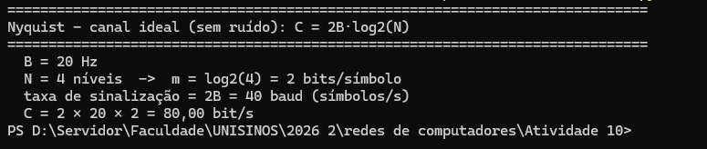{width=12}

O cálculo de Shannon foi executado duas vezes para o mesmo canal, uma com a SNR em dB e outra em escala linear. Os dois resultados são idênticos (29.901,68 bit/s), o que confere a conversão de dB (Figuras 2 e 3).

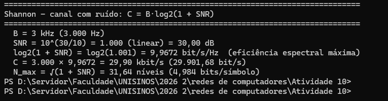{width=12}

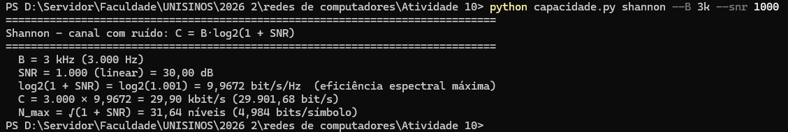{width=15}

O modo `comparar` coloca os dois modelos lado a lado para os mesmos B e SNR (Figura 4), e um valor de N que não é potência de 2 também é aceito: com N = 3, cada símbolo carrega log₂ 3 = 1,585 bit, o que só faz sentido como limite teórico (Figura 5).

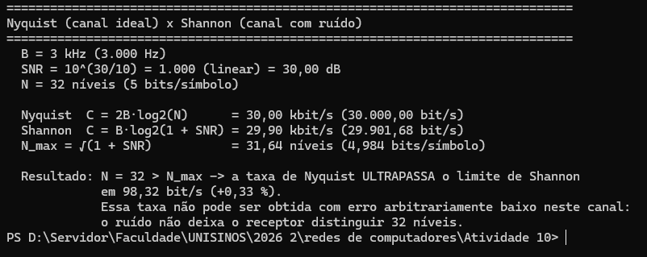{width=13}

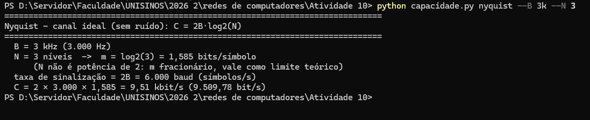{width=15}

### Validação da entrada

Valores sem sentido físico são recusados com uma mensagem de erro, em vez de gerar um resultado:

- **N = 1** (Figura 6): log₂ 1 = 0, ou seja, um sinal com um único nível nunca muda e não transporta informação. O programa exige N inteiro ≥ 2.
- **SNR = 1.000** (Figura 7): o próprio enunciado escreve a SNR com ponto de milhar (1.000 = mil), mas em Python "1.000" é lido como 1,0, e o resultado seria log₂(2) = 1 bit/s/Hz em vez de 9,967. Como as duas leituras são possíveis, o programa recusa a entrada e pede o número sem separador.

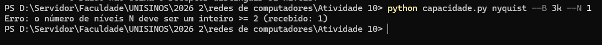{width=15}

{width=15}

Também são recusados B ≤ 0, SNR linear negativa, N fracionário e textos que não são números (essas entradas são testadas no modo `validar`).

---

## 3. Validação da implementação

Antes dos experimentos, o modo `validar` comparou o programa com os exemplos numéricos da aula 12 e com verificações que não dependem dos valores do enunciado. As 9 verificações passaram (Figura 8):

| Verificação | Resultado |
|---|---|
| Slide 14: Nyquist com B = 20 Hz e N = 4 | 80,00 bit/s (esperado 80 bit/s) |
| Slide 23: 30 dB em escala linear | 10^(30/10) = 1.000 |
| Slide 24: Shannon com B = 3.000 Hz e SNR = 1.000 | 29.901,68 bit/s, igual ao cálculo pelo caminho do slide (log₁₀ 1001 / log₁₀ 2) |
| Slide 24: valor do slide, com log₁₀ 1001 ≈ 3 e log₁₀ 2 ≈ 0,3 | 3.000 × 3/0,3 = 30.000 bit/s (diferença de 98,32 bit/s, 0,33 %) |
| Conversão dB → linear → dB | 5/5 valores voltam ao original |
| Identidade 2B·log₂√(1 + SNR) = B·log₂(1 + SNR) | 12/12 combinações de B e SNR |
| Nyquist com N = 2^m é exatamente 2B·m | 18/18 combinações |
| Extremos: SNR = 0 → C = 0; SNR = 0 dB → C = B | 0 bit/s e 5.000 bit/s (com B = 5 kHz) |
| Entradas inválidas são rejeitadas | 7/7 |

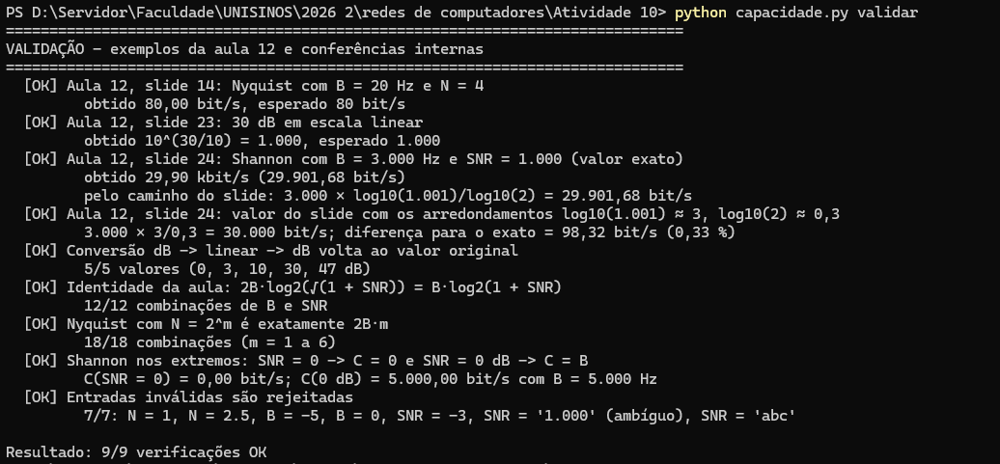{width=15.92}

O exemplo do slide 24 merece atenção. O slide chega a **30.000 bit/s** porque arredonda log₂(1001) para 10, mas o valor exato é **29.901,68 bit/s**. A diferença é pequena (0,33 %), mas muda a conclusão do Experimento 4, que usa exatamente esse canal (B = 3 kHz e 30 dB).

---

## 4. Experimento 1 – Capacidade de Nyquist

B = 1, 5 e 10 kHz e N = 2, 4, 8 e 16 níveis, com C = 2B·log₂(N). Capacidade em kbit/s:

| B \ N | 2 (1 bit) | 4 (2 bits) | 8 (3 bits) | 16 (4 bits) |
|---|---|---|---|---|
| 1 kHz | 2,00 | 4,00 | 6,00 | 8,00 |
| 5 kHz | 10,00 | 20,00 | 30,00 | 40,00 |
| 10 kHz | 20,00 | 40,00 | 60,00 | 80,00 |

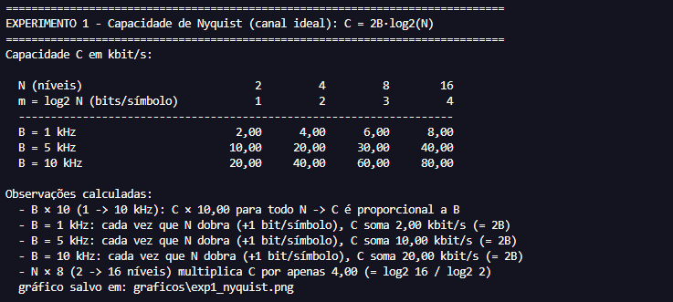{width=15}

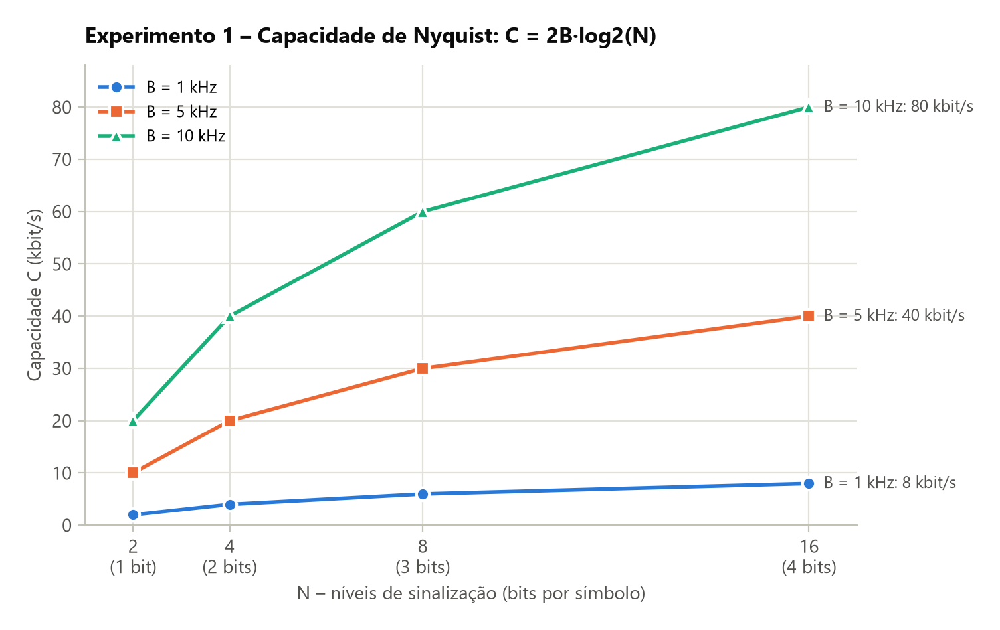{width=15.92}

### Como a largura de banda influencia a capacidade?

A capacidade é diretamente proporcional a B. De 1 para 10 kHz, C foi multiplicada por exatamente 10 para todos os valores de N (por exemplo, de 8 para 80 kbit/s com N = 16). Pelo teorema de Nyquist, um canal com largura de banda B transmite no máximo 2B símbolos por segundo, e a capacidade é essa taxa de símbolos vezes os bits por símbolo.

### Qual é o impacto de aumentar o número de bits por símbolo?

Cada bit a mais por símbolo soma 2B bit/s à capacidade: +2, +10 e +20 kbit/s para B = 1, 5 e 10 kHz, constante ao longo de toda a tabela. Mas cada bit a mais exige **dobrar** o número de níveis. Por isso a capacidade cresce de forma linear com os bits por símbolo e só logarítmica com N: multiplicar N por 8 (de 2 para 16 níveis) multiplicou C por apenas 4. No gráfico, as curvas ficam cada vez mais "achatadas" à medida que N aumenta.

### Por que Nyquist, isoladamente, não representa um canal com ruído?

Porque a fórmula não tem nenhum termo de ruído: para B fixo, basta aumentar N para a capacidade crescer sem limite. A aula 12 (slide 15) aponta exatamente isso: Nyquist não considerou um limite para N. Num canal real, com a amplitude máxima do sinal fixa, mais níveis significam níveis mais próximos uns dos outros, e quando a distância entre eles fica menor que o ruído, o receptor não consegue mais distingui-los. O Experimento 4 mostra esse limite em números.

---

## 5. Experimento 2 – Capacidade de Shannon

SNR = 1.000, 5.000, 10.000 e 50.000 (escala linear) e B de 1 a 10 kHz, com C = B·log₂(1 + SNR). Capacidade em kbit/s:

| B \ SNR | 1.000 (30,0 dB) | 5.000 (37,0 dB) | 10.000 (40,0 dB) | 50.000 (47,0 dB) |
|---|---|---|---|---|
| log₂(1 + SNR) | 9,967 bit/s/Hz | 12,288 bit/s/Hz | 13,288 bit/s/Hz | 15,610 bit/s/Hz |
| 1 kHz | **9,97** (menor) | 12,29 | 13,29 | 15,61 |
| 2 kHz | 19,93 | 24,58 | 26,58 | 31,22 |
| 3 kHz | 29,90 | 36,86 | 39,86 | 46,83 |
| 4 kHz | 39,87 | 49,15 | 53,15 | 62,44 |
| 5 kHz | 49,84 | 61,44 | 66,44 | 78,05 |
| 6 kHz | 59,80 | 73,73 | 79,73 | 93,66 |
| 7 kHz | 69,77 | 86,02 | 93,01 | 109,27 |
| 8 kHz | 79,74 | 98,30 | 106,30 | 124,88 |
| 9 kHz | 89,71 | 110,59 | 119,59 | 140,49 |
| 10 kHz | 99,67 | 122,88 | 132,88 | **156,10** (maior) |

- **Maior capacidade:** 156,10 kbit/s (156.096,69 bit/s), com B = 10 kHz e SNR = 50.000.
- **Menor capacidade:** 9,97 kbit/s (9.967,23 bit/s), com B = 1 kHz e SNR = 1.000.

A razão entre as duas é 15,66. Desse fator, o aumento de B (×10) contribuiu com ×10, e o aumento de SNR (×50) só com ×1,566.

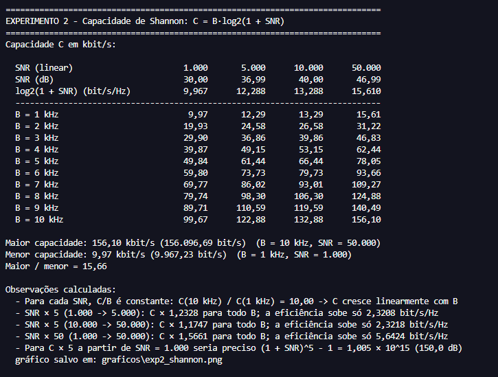{width=15}

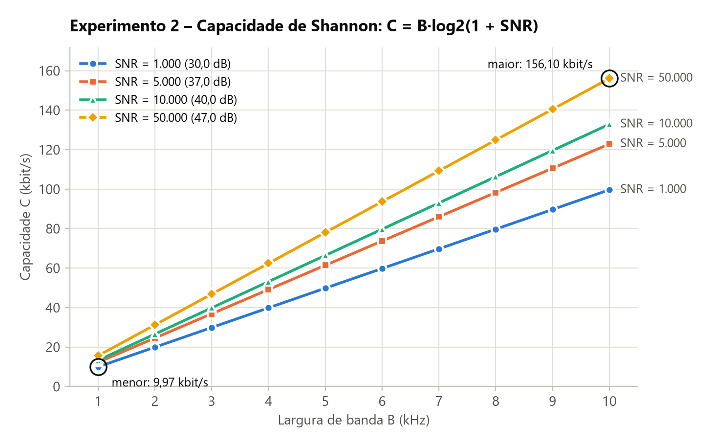{width=15.92}

### Como a capacidade varia com B?

Linearmente. Para cada SNR, a razão C/B é constante e igual a log₂(1 + SNR), a eficiência espectral máxima do canal (9,967 bit/s/Hz para SNR = 1.000, por exemplo). Por isso as quatro curvas do gráfico são retas que partem da origem, e C(10 kHz)/C(1 kHz) = 10 para todas as SNRs.

### Qual é o impacto do aumento da SNR?

A SNR aumenta a inclinação das retas, mas pouco. Multiplicar a SNR por 50 (de 1.000 para 50.000) multiplicou a capacidade por apenas 1,566, enquanto multiplicar B por 10 multiplicou a capacidade por 10. A SNR entra na fórmula dentro do logaritmo, e B entra fora dele.

### Multiplicar a SNR por cinco multiplica a capacidade por cinco?

Não. De 1.000 para 5.000, a capacidade foi multiplicada por **1,2328**, e de 10.000 para 50.000 por **1,1747**, para qualquer B. Multiplicar a SNR por 5 **soma** cerca de log₂ 5 ≈ 2,32 bit/s/Hz à eficiência (o programa mediu 2,3208 e 2,3218), em vez de multiplicar o resultado. Para que a capacidade realmente quintuplicasse a partir de SNR = 1.000, seria preciso (1 + SNR)⁵ − 1 ≈ 1,005 × 10¹⁵, ou seja, 150 dB, um valor fora de qualquer realidade. Já multiplicar B por 5 multiplica a capacidade por 5.

---

## 6. Experimento 3 – Influência do ruído

B = 5 kHz e SNR de 0 a 40 dB, em passos de 5 dB, com SNR = 10^(SNR_dB/10) e C = B·log₂(1 + SNR):

| SNR (dB) | SNR (linear) | log₂(1 + SNR) | C (kbit/s) | ΔC em relação a 5 dB antes |
|---|---|---|---|---|
| 0 | 1,00 | 1,000 | 5,00 | – |
| 5 | 3,16 | 2,057 | 10,29 | +5,29 |
| 10 | 10,00 | 3,459 | 17,30 | +7,01 |
| 15 | 31,62 | 5,028 | 25,14 | +7,84 |
| 20 | 100,00 | 6,658 | 33,29 | +8,15 |
| 25 | 316,23 | 8,309 | 41,55 | +8,26 |
| 30 | 1.000,00 | 9,967 | 49,84 | +8,29 |
| 35 | 3.162,28 | 11,627 | 58,14 | +8,30 |
| 40 | 10.000,00 | 13,288 | 66,44 | +8,30 |

Comparação em 10, 20, 30 e 40 dB:

| SNR (dB) | C (kbit/s) | ΔC (+10 dB) | C / C(10 dB antes) | C/B (bit/s/Hz) |
|---|---|---|---|---|
| 10 | 17,30 | – | – | 3,459 |
| 20 | 33,29 | +15,99 | 1,925 | 6,658 |
| 30 | 49,84 | +16,55 | 1,497 | 9,967 |
| 40 | 66,44 | +16,60 | 1,333 | 13,288 |

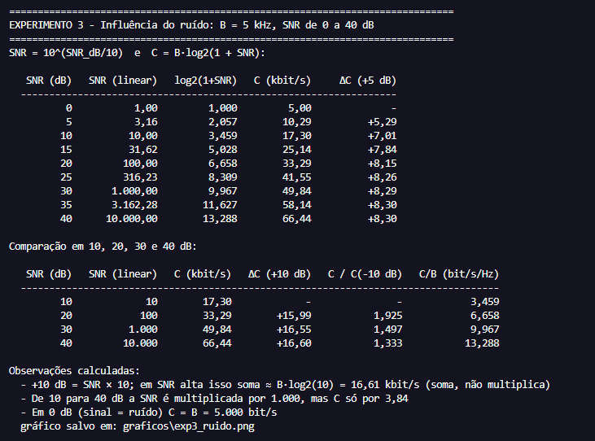{width=15}

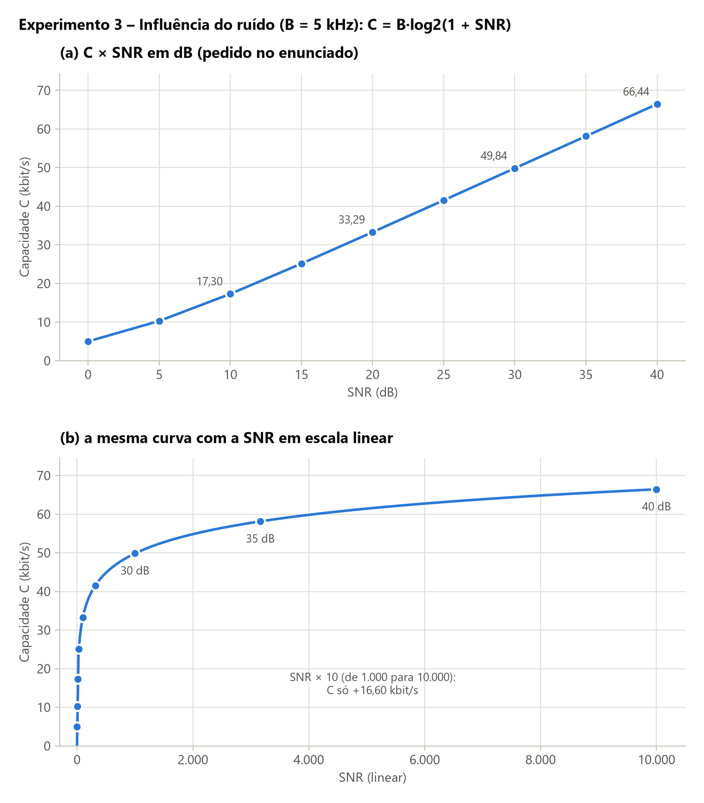{width=15.92}

### Qual é o impacto de aumentar a SNR em 10 dB?

Somar 10 dB é multiplicar a SNR por 10, e isso **soma** à capacidade um valor quase constante: +15,99, +16,55 e +16,60 kbit/s, que se aproxima de B·log₂ 10 = 16,61 kbit/s (cerca de 3,32 bit/s/Hz). O ganho relativo, por outro lado, cai a cada passo: ×1,925, ×1,497 e ×1,333. De 10 para 40 dB, a SNR foi multiplicada por 1.000, e a capacidade por apenas 3,84.

### Por que a relação entre SNR e capacidade não é linear?

Porque a capacidade depende de log₂(1 + SNR). No gráfico (b), com a SNR em escala linear, a curva sobe rápido no início e depois quase não sai do lugar: de SNR = 1.000 para 10.000 o ganho é de só 16,60 kbit/s. No gráfico (a) a curva parece quase uma reta, porque o dB já é uma escala logarítmica. Mesmo assim, ela não é reta perto de 0 dB: os ganhos a cada 5 dB crescem de 5,29 para 8,30 kbit/s e só então se estabilizam, porque log₂(1 + SNR) só se comporta como log₂(SNR) quando a SNR é bem maior que 1.

### Como o ruído limita a capacidade?

O ruído define quantos níveis do sinal o receptor ainda consegue distinguir, N_max = √(1 + SNR), e, portanto, quantos bits cada símbolo pode carregar. Em 0 dB (potência do sinal igual à do ruído), N_max = √2 ≈ 1,41 níveis e a capacidade é igual a B (5 kbit/s). Em 40 dB, o canal chega a 13,29 bit/s/Hz (66,44 kbit/s). Para qualquer SNR finita, a capacidade é finita, não importa a modulação usada: com mais ruído a SNR cai, e a capacidade cai junto.

---

## 7. Experimento 4 – Nyquist versus Shannon

B = 3 kHz, SNR = 30 dB (1.000 em escala linear) e N = 2, 4, 8, 16, 32 e 64 níveis.

- Limite de Shannon: C = 3.000 × log₂(1 + 1.000) = **29,90 kbit/s** (29.901,68 bit/s).
- Número máximo de níveis distinguíveis: N_max = √1001 = **31,64 níveis** (4,984 bits por símbolo).

| N | Bits por símbolo | Nyquist (kbit/s) | Shannon (kbit/s) | Nyquist / Shannon | Situação |
|---|---|---|---|---|---|
| 2 | 1 | 6,00 | 29,90 | 20,1 % | dentro do limite |
| 4 | 2 | 12,00 | 29,90 | 40,1 % | dentro do limite |
| 8 | 3 | 18,00 | 29,90 | 60,2 % | dentro do limite |
| 16 | 4 | 24,00 | 29,90 | 80,3 % | dentro do limite |
| 32 | 5 | 30,00 | 29,90 | 100,3 % | **ultrapassa (+98,32 bit/s)** |
| 64 | 6 | 36,00 | 29,90 | 120,4 % | **ultrapassa (+6.098,32 bit/s)** |

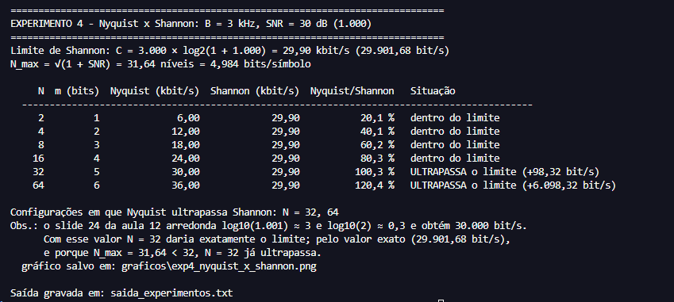{width=15.92}

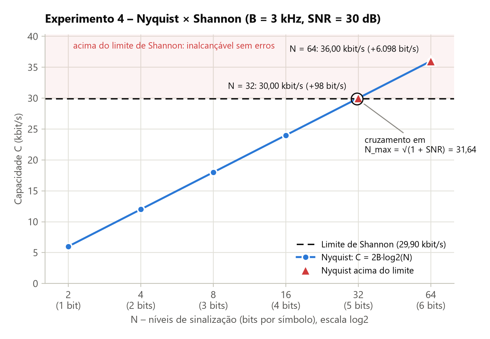{width=15.92}

**Configurações em que a taxa de Nyquist ultrapassa o limite de Shannon: N = 32 e N = 64.** Com N = 32 a diferença é de apenas 98,32 bit/s (0,33 %), e é aqui que o arredondamento do slide 24 da aula 12 faz diferença: com o valor do slide (30.000 bit/s), N = 32 daria exatamente o limite. Pelo valor exato, e também porque N_max = 31,64 é menor que 32, N = 32 já ultrapassa. No gráfico, a reta de Nyquist cruza o limite exatamente em N = N_max.

### Por que aumentar N não permite superar o limite de Shannon?

Porque, com a SNR fixa, o receptor só distingue até N_max = √(1 + SNR) ≈ 31,64 níveis. Com 32 ou 64 níveis, os níveis vizinhos ficam mais próximos do que o ruído permite separar, e o receptor passa a confundir um com outro. A fórmula de Nyquist ainda devolve um número (36 kbit/s com N = 64), mas essa taxa não pode ser obtida sem erros. O teorema de Shannon diz que, acima de C, nenhuma codificação consegue tornar a probabilidade de erro tão baixa quanto se queira, então os bits que passam corretamente nunca ultrapassam os 29,90 kbit/s.

### Qual a diferença entre o canal ideal e o canal com ruído?

No canal ideal (Nyquist) o único limite é a largura de banda, que fixa a taxa de símbolos em 2B (6.000 símbolos por segundo aqui). A capacidade cresce sem limite com N: 6, 12, 18, 24, 30, 36 kbit/s, e continuaria subindo. No canal com ruído (Shannon) existe um teto que depende só de B e da SNR, 29,90 kbit/s neste canal, seja qual for a modulação. Esse teto é um limite teórico superior. Na prática, codificações e modulações reais ficam abaixo dele (aula 12, slide 21).

### Por que B, codificação e SNR devem ser considerados conjuntamente?

Porque cada um define uma parte da taxa. B define quantos símbolos por segundo o canal aceita (2B), a codificação ou modulação define quantos bits vão em cada símbolo (log₂ N), e a SNR define quantos bits por símbolo o receptor consegue distinguir (log₂ N_max = 4,98 aqui). Olhar só um deles leva a conclusões erradas. Nyquist sozinho "promete" 36 kbit/s com 64 níveis. Shannon sozinho diz o teto, mas não diz que modulação usar. Neste canal, a maior potência de 2 dentro do limite é N = 16 (24 kbit/s, 80,3 % da capacidade). Para passar de 29,90 kbit/s é preciso aumentar B, que tem efeito linear, ou a SNR, que tem efeito logarítmico. Pela tabela do Experimento 2, com B = 3 kHz, passar de 30 para 40 dB (SNR de 1.000 para 10.000) leva o limite de 29,90 para só 39,86 kbit/s, enquanto dobrar B dobra o limite. Além disso, modulações reais precisam de uma folga de SNR para manter a taxa de erro de bits baixa, o que afasta ainda mais a taxa prática do limite.

---

## 8. Uso de Inteligência Artificial

**Ferramenta utilizada:** Claude (Anthropic), via Claude Code.

**Etapas em que ajudou:** leitura do enunciado e da aula 12, incluindo a extração das fórmulas dos slides 18 a 24, que estavam como imagem; planejamento (`planejamento.md`); escrita do programa `capacidade.py`, inclusive o modo de validação e os gráficos; previsão dos resultados de cada experimento, calculados à mão antes da primeira execução; e redação deste relatório a partir das saídas reais.

**Como as sugestões foram validadas:**

- O programa foi executado por mim, e as tabelas, os gráficos e os prints deste relatório são dessa execução (31/10 e 01/11/2026). A saída foi idêntica à do teste feito pela IA durante o desenvolvimento.
- O modo `validar` reproduziu os exemplos numéricos da aula 12 (80 bit/s no slide 14; 30 dB = 1.000 no slide 23; o canal telefônico do slide 24) e passou nas verificações internas (9/9).
- O cálculo de Shannon foi feito por dois caminhos (`--snr-db 30` e `--snr 1000`) e deu o mesmo resultado.
- As previsões do `planejamento.md`, feitas antes de executar o programa, foram comparadas com as saídas.

**Previsões confirmadas pela execução:**

- Nyquist: 2, 4, 6 e 8 kbit/s para B = 1 kHz, e 5 e 10 vezes esses valores para 5 e 10 kHz.
- Shannon: menor capacidade de 9,97 kbit/s (1 kHz, SNR = 1.000) e maior de 156,1 kbit/s (10 kHz, SNR = 50.000); SNR × 5 multiplicando C por cerca de 1,23, e não por 5.
- Ruído: 17,30, 33,29, 49,84 e 66,44 kbit/s em 10, 20, 30 e 40 dB, com ganho de cerca de 16,6 kbit/s a cada 10 dB.
- Nyquist × Shannon: N = 32 e N = 64 ultrapassariam o limite de 29,90 kbit/s, e N = 32 só por cerca de 98 bit/s.

**Sugestão confirmada e adaptada:** ao ler o slide 24, a IA apontou que o resultado de 30.000 bit/s vem de dois arredondamentos (log₁₀ 1001 ≈ 3 e log₁₀ 2 ≈ 0,3) e que o valor exato é 29.901,68 bit/s. Isso foi confirmado pelo modo `validar`, que calcula os dois valores. A observação foi incorporada à análise do Experimento 4, porque decide se N = 32 fica "no limite" ou "acima" dele.

**Sugestões corrigidas:**

- A IA previu que multiplicar a SNR por 5 somaria **exatamente** log₂ 5 = 2,3219 bit/s/Hz à eficiência. O programa mediu 2,3208 (de 1.000 para 5.000) e 2,3218 (de 10.000 para 50.000). A diferença vem do "+1" da fórmula: log₂(1 + 5·SNR) − log₂(1 + SNR) só tende a log₂ 5 quando a SNR é muito maior que 1. O relatório usa os valores medidos e trata log₂ 5 como aproximação.
- Na primeira versão do gráfico do Experimento 4, N_max era desenhado como uma linha vertical. No eixo em escala log₂, essa linha ficava praticamente em cima de N = 32 (31,64 contra 32) e cortava os rótulos e a legenda. Ela foi trocada pela marcação do ponto em que a reta de Nyquist cruza o limite de Shannon, que é o próprio N_max.
- Nos testes, as mensagens de erro saíram com os acentos trocados, porque só a saída normal do programa estava em UTF-8, e não a saída de erros. Isso foi corrigido antes da execução oficial.

---

## 9. Conclusão

Os modelos de Nyquist e de Shannon foram implementados num programa que recebe os parâmetros, mostra os resultados com unidades e reproduz os exemplos da aula 12. Os quatro experimentos mostraram três comportamentos diferentes. A capacidade cresce linearmente com a largura de banda, linearmente com os bits por símbolo e apenas logaritmicamente com o número de níveis e com a SNR. Multiplicar B por 10 multiplicou a capacidade por 10, e multiplicar a SNR por 50 a multiplicou por apenas 1,57.

O Experimento 4 juntou os dois modelos. Num canal de 3 kHz com 30 dB, Nyquist permite escolher qualquer N, mas o ruído limita os níveis distinguíveis a cerca de 31,6, e a capacidade a 29,90 kbit/s. Com 32 níveis ou mais, a taxa calculada por Nyquist passa desse limite e já não pode ser obtida sem erros. A comparação também mostrou que o arredondamento usado no slide da aula (30.000 bit/s) esconde justamente esse caso.

---

## Apêndice A – Código-fonte completo (`capacidade.py`)

{{codigo:capacidade.py}}
