# Atividade 11 – Codificação de Banda Base e Modulação Digital

**Nome:** Matheus Milanezi
**Disciplina:** Redes de Computadores: Internetworking, Roteamento e Transmissão
**Linguagem:** Python 3.14 (arquivo único `codificacao_modulacao.py`; numpy 2.5 e matplotlib 3.11)
**Execução:** 14/11/2026, no PowerShell (Windows 10), dentro da pasta da atividade

---

## 1. Objetivo

Implementar três códigos de linha (NRZ unipolar, NRZ polar e Manchester) e três modulações digitais (ASK, FSK e BPSK), gerar os sinais no tempo para a mesma sequência de bits e compará-los, sem ruído e com ruído, para ver como cada técnica representa os bits e qual o custo de cada uma em tolerância ao ruído e em largura de banda.

---

## 2. Implementação

### Parâmetros

| Parâmetro | Valor | Observação |
|---|---|---|
| Sequência de bits | 1011000001101001 (16 bits) | A dos slides 13 e 14 da aula 13 (14 bits), completada com 01 |
| Taxa de bits (Rb) | 1.000 bit/s | Duração de cada bit Tb = 1 ms |
| Nível dos códigos de linha (V) | 1 V | |
| Portadora (fc) | 2.000 Hz | 2 ciclos por bit |
| Frequências do FSK | f0 = 2.000 Hz e f1 = 4.000 Hz | f1 = 2·fc, como no slide 20 |
| Amplitude da portadora (A) | 1 V | |
| Frequência de amostragem (fs) | 100.000 Hz | 100 amostras por bit e 25 por ciclo na maior frequência (4 kHz) |

A portadora é e(t) = A·sen(2π·f·t + θ), com os parâmetros do slide 18 (amplitude, frequência e fase). Como fc e f1 têm um número inteiro de ciclos por bit, a portadora começa cada bit no mesmo ponto, e o FSK troca de frequência sem salto de fase.

A sequência foi escolhida para que as figuras possam ser comparadas diretamente com as dos slides 13 e 14, e porque ela tem um trecho de cinco zeros seguidos, que mostra o problema de sincronismo do NRZ. O programa também aceita qualquer outra sequência (`--bits`) ou um texto ASCII, convertido em 8 bits por caractere (`--texto`).

### Convenções adotadas

| Técnica | Bit 0 | Bit 1 | Fonte |
|---|---|---|---|
| NRZ unipolar | 0 V | +V | Aula 13, slide 13 |
| NRZ polar | −V | +V | Aula 13, slides 12 e 13 |
| Manchester | descida no meio do bit (+V → −V) | subida no meio do bit (−V → +V) | Aula 13, slide 14 (mesma convenção do IEEE 802.3) |
| ASK | amplitude 0 | amplitude A | Aula 13, slide 20 |
| FSK | frequência f0 = fc = 2 kHz | frequência f1 = 2·fc = 4 kHz | Aula 13, slide 20 |
| BPSK | fase 180° (−A·sen) | fase 0° (+A·sen) | Aula 13, slides 23 e 26 |

Dois cuidados com as convenções:

- **Manchester:** existe também a convenção oposta (G. E. Thomas), em que o 1 é a descida. Foi usada a do slide 14, conferida seta por seta no modo `validar` (seção 3).
- **BPSK:** os slides da aula 13 não concordam entre si. A tabela do slide 20 associa o bit 0 à fase 0° e o bit 1 à fase 180°, mas a figura do slide 23 e a constelação do slide 26 fazem o contrário (bit 0 em −A, bit 1 em +A). Foi adotada a segunda forma. As duas funcionam, desde que transmissor e receptor usem a mesma.

### Ruído e receptor

O ruído é branco, gaussiano e aditivo (AWGN, slide 5). O nível de ruído é dado por **Eb/N0**, a energia média de um bit dividida pela densidade de potência do ruído. Com Eb/N0 fixa, cada técnica recebe um ruído proporcional à energia média do seu bit, o que permite comparar técnicas diferentes de forma justa. Num sinal amostrado a fs, um ruído de densidade N0/2 tem variância N0·fs/2 em cada amostra.

O receptor decide cada bit pela **correlação** do intervalo recebido com a forma de onda esperada: em vez de olhar uma amostra, ele combina as 100 amostras do bit. O sinal se soma de forma coerente, e o ruído, que é aleatório, se cancela em parte.

| Técnica | Decisão em cada bit |
|---|---|
| NRZ unipolar | Média do nível no bit; é 1 se passar de V/2 |
| NRZ polar | Média do nível no bit; é 1 se for positiva |
| Manchester | Média da 2ª metade menos a da 1ª; é 1 se for positiva (subida) |
| ASK | Correlação com a portadora; é 1 se passar da metade do valor esperado para o bit 1 |
| FSK | Correlação com f1 menos a correlação com f0; vence a frequência que "encaixa" melhor |
| BPSK | Correlação com a portadora; o sinal do resultado decide o bit |

### Estrutura do programa

| Função | O que faz |
|---|---|
| `nrz_unipolar`, `nrz_polar`, `manchester` | Geram as amostras dos códigos de linha |
| `ask`, `fsk`, `bpsk` | Geram as amostras dos sinais modulados |
| `medir_nrz`, `medir_manchester`, `medir_ask`, `medir_fsk` | Calculam a estatística de decisão de cada bit (receptores) |
| `Tecnica` (classe), `CODIGOS`, `MODULACOES` | Juntam o nome, a convenção, o transmissor, o receptor e o limiar de cada técnica |
| `awgn`, `energia_bit` | Somam o ruído para uma Eb/N0 e calculam a energia média por bit |
| `ber_teorica`, `ebn0_necessario` | Taxa de erro teórica e Eb/N0 necessária para uma taxa de erro alvo |
| `transicoes`, `trecho_sem_transicao`, `densidade_espectral` | Contam transições, acham o maior trecho sem transição e calculam o espectro |
| `experimento_1` a `experimento_5` | Imprimem as tabelas e geram as figuras |
| `modo_validar` | Confere as convenções da aula 13 e o simulador |

Formas de execução:

```
python codificacao_modulacao.py                          todos os experimentos
python codificacao_modulacao.py codificar --bits 1011…   códigos de linha
python codificacao_modulacao.py codificar --texto "Re"   idem, a partir de texto
python codificacao_modulacao.py modular --bits 1011…     ASK, FSK e BPSK
python codificacao_modulacao.py ruido --ebn0 0           transmissão com ruído
python codificacao_modulacao.py validar                  verificações automáticas
```

As figuras são salvas na pasta `graficos/`, e a saída completa dos experimentos é gravada em `saida_experimentos.txt`. **A saída completa da execução está no Anexo**, e o código-fonte completo, no **Apêndice A**.

---

## 3. Validação da implementação

Antes dos experimentos, o modo `validar` conferiu o programa contra as figuras da aula 13 e contra resultados que não dependem dos experimentos. As 11 verificações passaram (Figura 1):

| Verificação | Resultado |
|---|---|
| Sem ruído, o receptor devolve os bits enviados | 6/6 técnicas, com a sequência padrão e com 1.000 bits aleatórios |
| Slide 13: níveis do NRZ polar para a sequência do slide | `+-++-----++-+-`, igual ao slide |
| Slide 14: sentido da transição Manchester em cada bit | `SDSSDDDDDSSDSD` (S = subida, D = descida), igual ao slide |
| Manchester: uma transição no meio de todo bit, e na borda só entre bits iguais | 1.502 transições = 1.000 bits + 502 pares de bits iguais |
| Níveis do NRZ | unipolar {0, 1} V e polar {−1, 1} V |
| Portadoras com número inteiro de ciclos por bit; FSK sem salto de fase | 2 e 4 ciclos; maior passo na borda do bit (0,249 V) igual ao maior passo dentro do sinal (0,251 V) |
| f0 e f1 ortogonais em um bit | correlação normalizada de 8,8·10⁻¹⁷ (zero numérico) |
| Energia média por bit medida nas amostras = valor teórico | 6/6 (BPSK: A²·Tb/2 = 5,00·10⁻⁴ V²·s; ASK: A²·Tb/4, porque metade dos bits não tem sinal) |
| Ruído com a variância pedida | desvio medido de 7,0603 V para 7,0711 V esperados |
| Taxa de erro simulada igual à teórica em Eb/N0 = 4 dB | 6/6 dentro de 4 desvios padrão, com 200.000 bits |
| Entradas inválidas são rejeitadas | 6/6 |

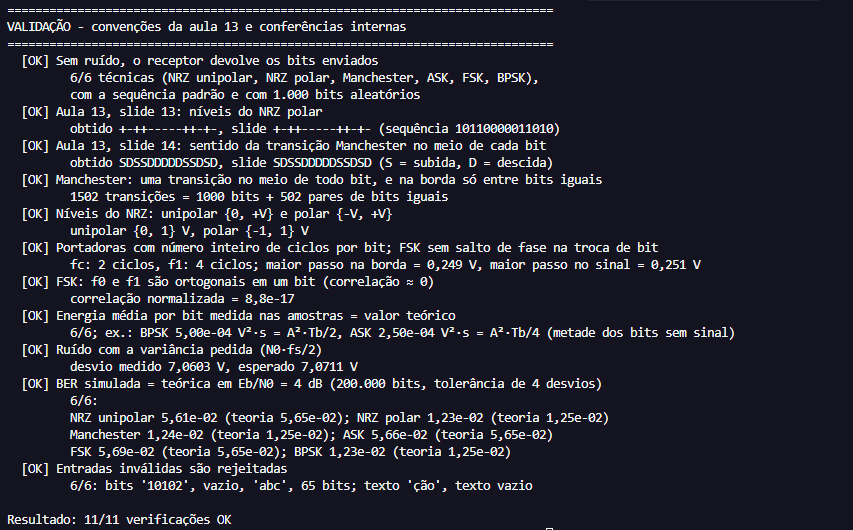{width=15}

---

## 4. Parte 1 – Codificação de banda base

A Figura 2 mostra a sequência 1011000001101001 nos três códigos, com o relógio (cadência) de referência, como nos slides 13 e 14. As linhas tracejadas marcam os limites de cada bit, e as setas no Manchester marcam a transição do meio do bit.

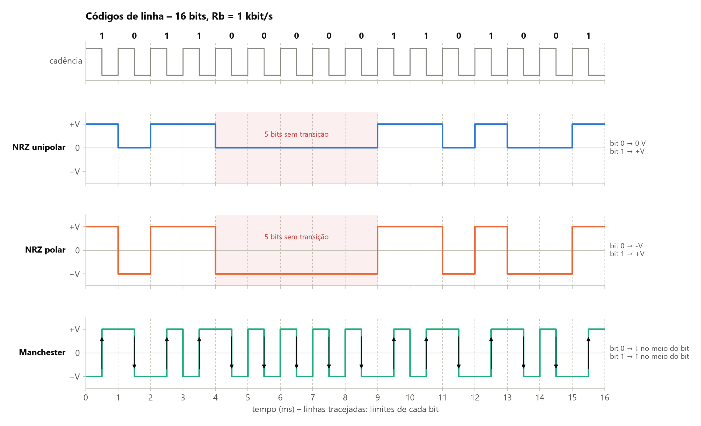{width=15.92}

Níveis em cada bit (↑ = subida de −V para +V no meio do bit; ↓ = descida de +V para −V):

| Bit | 1 | 0 | 1 | 1 | 0 | 0 | 0 | 0 | 0 | 1 | 1 | 0 | 1 | 0 | 0 | 1 |
|---|---|---|---|---|---|---|---|---|---|---|---|---|---|---|---|---|
| NRZ unipolar | +V | 0 | +V | +V | 0 | 0 | 0 | 0 | 0 | +V | +V | 0 | +V | 0 | 0 | +V |
| NRZ polar | +V | −V | +V | +V | −V | −V | −V | −V | −V | +V | +V | −V | +V | −V | −V | +V |
| Manchester | ↑ | ↓ | ↑ | ↑ | ↓ | ↓ | ↓ | ↓ | ↓ | ↑ | ↑ | ↓ | ↑ | ↓ | ↓ | ↑ |

Comparação medida pelo programa (a sequência tem 7 uns e 9 zeros):

| Código | Transições em 16 bits | Maior trecho sem transição | Nível médio (componente DC) |
|---|---|---|---|
| NRZ unipolar | 8 | 5 bits | +0,438 V |
| NRZ polar | 8 | 5 bits | −0,125 V |
| Manchester | 23 (16 no meio dos bits + 7 entre bits iguais) | 1 bit | 0 V |

Nos dois NRZ, o sinal fica 5 ms parado durante os cinco zeros (trecho destacado na Figura 2), e o nível médio depende de quantos uns e zeros a mensagem tem. No Manchester, todo bit tem uma transição e passa metade do tempo em +V e metade em −V, então o nível médio é zero em cada bit, qualquer que seja a mensagem.

A Figura 3 mostra a entrada por texto: "Re" vira os 16 bits 01010010 01100101 (códigos ASCII 0x52 e 0x65). Essa sequência alterna mais, então os NRZ têm 11 transições e nenhum trecho parado maior que 2 bits. O Manchester continua com uma transição por bit (20 no total).

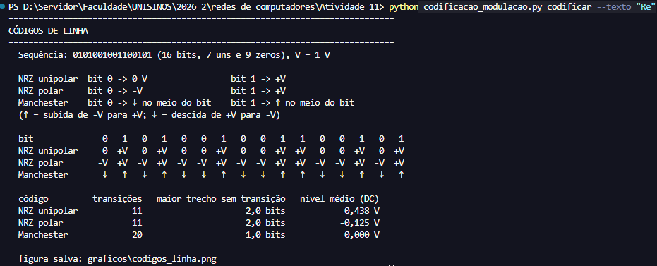{width=15.92}

Sequências inválidas são recusadas com uma mensagem de erro (Figura 4). Também são recusados textos com caracteres fora da tabela ASCII, entradas vazias e sequências maiores que 64 bits, que não caberiam na figura. Essas entradas são testadas no modo `validar`.

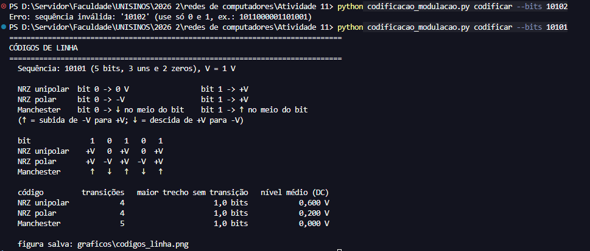{width=15.92}

---

## 5. Parte 2 – Modulação digital

A Figura 5 mostra a mesma sequência modulada em ASK, FSK e BPSK, com a portadora de referência. Acima de cada bit está o valor do parâmetro que mudou.

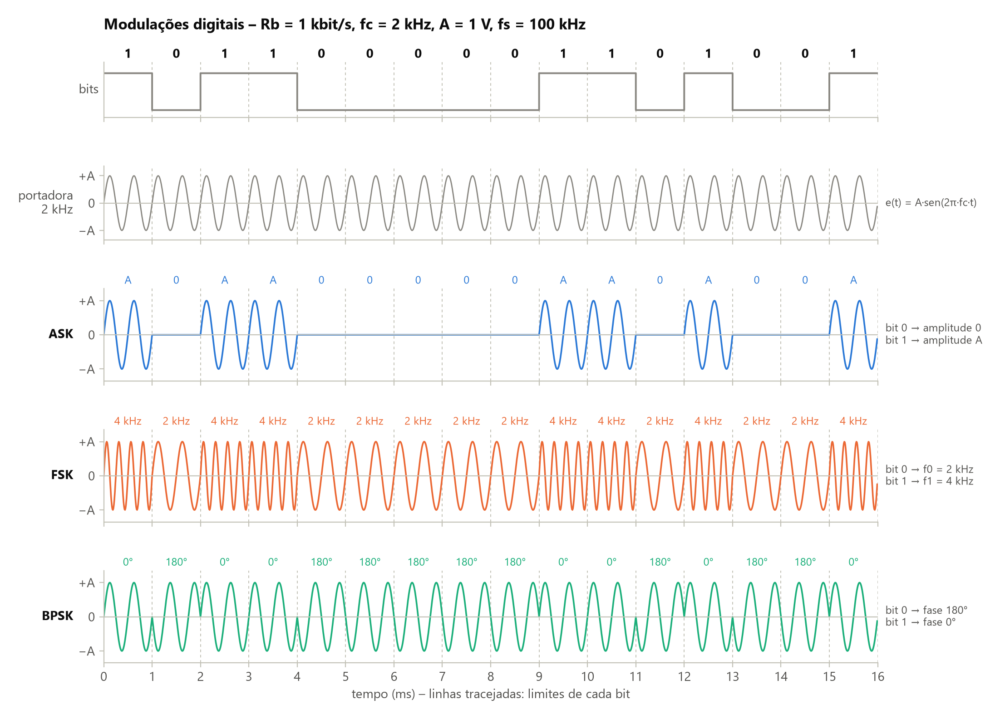{width=15.92}

Qual parâmetro da portadora representa os bits em cada técnica:

- **ASK – amplitude.** O bit 1 é a portadora com amplitude A, e o bit 0 é amplitude zero (a linha fica parada). Frequência e fase não mudam. Na figura, os cinco zeros aparecem como 5 ms sem sinal.
- **FSK – frequência.** A amplitude é sempre A. O bit 0 usa 2 kHz (2 ciclos por bit), e o bit 1 usa 4 kHz (4 ciclos por bit). Na figura, os bits 1 têm o dobro de ondas.
- **BPSK – fase.** Amplitude e frequência são sempre as mesmas. O bit 1 é a portadora com fase 0° (igual à de referência), e o bit 0 é a portadora invertida, com fase 180°. Na figura, cada troca de bit aparece como um "bico" no ponto em que a onda muda de sentido (por exemplo, em 1 ms, 2 ms e 4 ms).

---

## 6. Testes com ruído

### Os 16 bits com ruído

A mesma sequência foi transmitida com Eb/N0 = 10 dB e 0 dB (semente 2026):

| Técnica | σ do ruído (10 dB) | Erros (10 dB) | σ do ruído (0 dB) | Bits recebidos (0 dB, x = erro) | Erros (0 dB) |
|---|---|---|---|---|---|
| NRZ unipolar | 1,58 V | 0 | 5,00 V | 1011x0x001x01001 | 3 |
| NRZ polar | 2,24 V | 0 | 7,07 V | 1x1x000001101001 | 2 |
| Manchester | 2,24 V | 0 | 7,07 V | 1011000001xx1001 | 2 |
| ASK | 1,12 V | 0 | 3,54 V | 101100x001101x01 | 2 |
| FSK | 1,58 V | 0 | 5,00 V | x011000x01x01001 | 3 |
| BPSK | 1,58 V | 0 | 5,00 V | 1011000001101001 | 0 |

O desvio padrão do ruído (σ) é maior que a amplitude do sinal (1 V) em todos os casos. Isso acontece porque o ruído se espalha por toda a faixa amostrada (0 a fs/2 = 50 kHz), enquanto o sinal ocupa poucos kHz: a SNR por amostra é Eb/N0 − 17 dB, ou seja, −7 dB e −17 dB. Olhando a forma de onda, o sinal quase desaparece (Figuras 6 a 8), mas o receptor não decide por uma amostra: a correlação soma as 100 amostras do bit, e as barras de decisão mostram que, em 10 dB, todos os bits ficam bem longe do limiar.

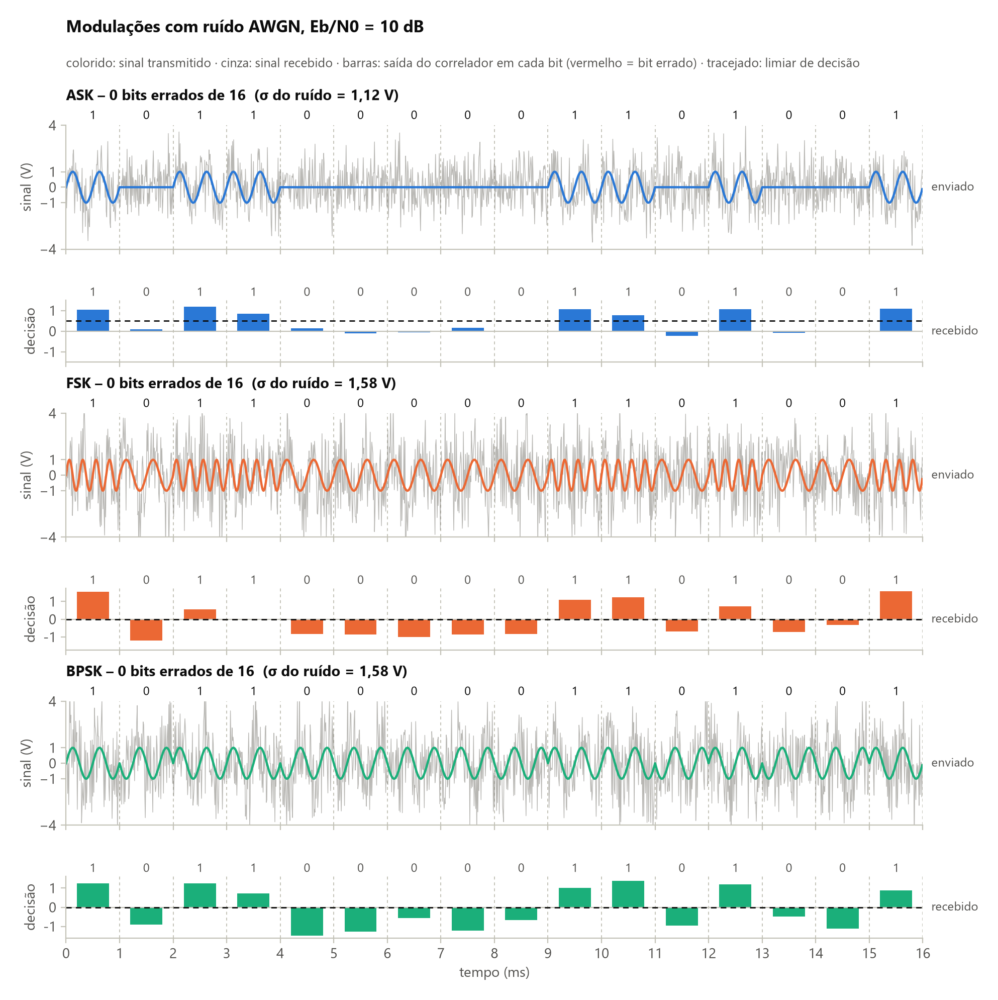{width=12.5}

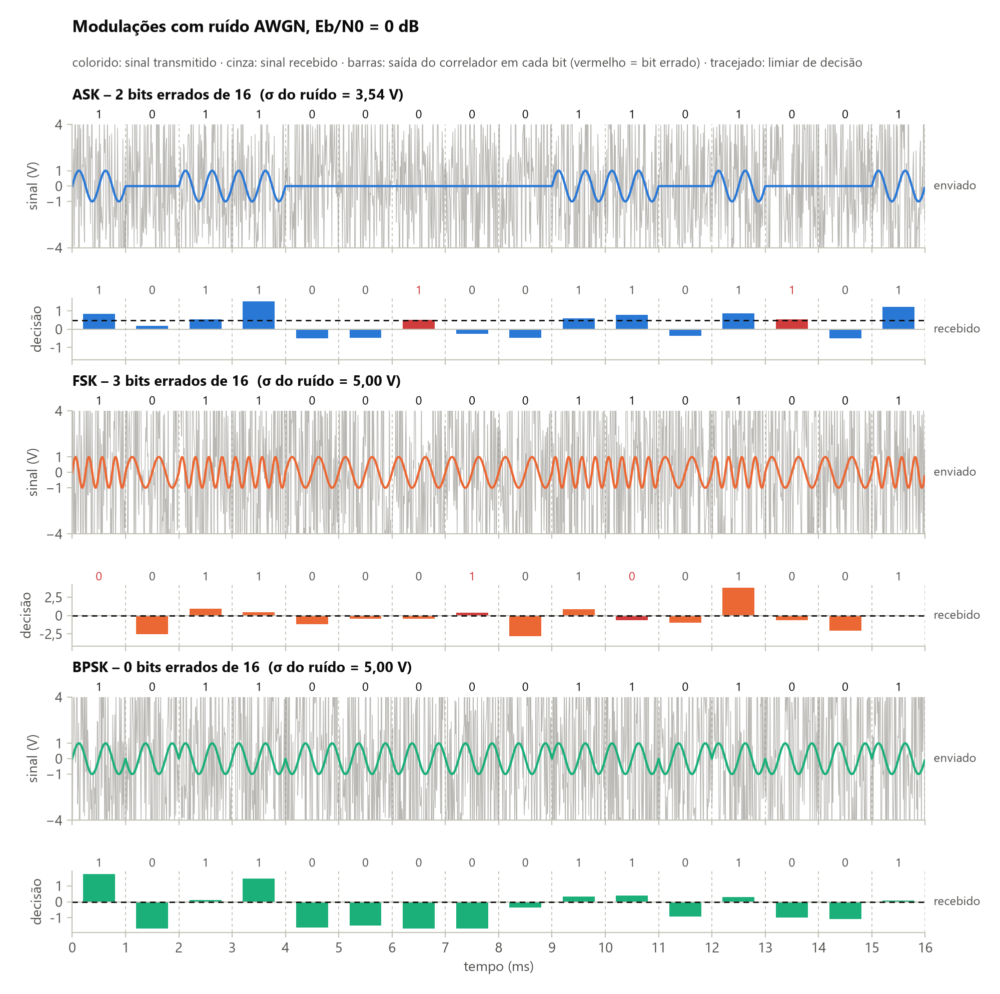{width=15.92}

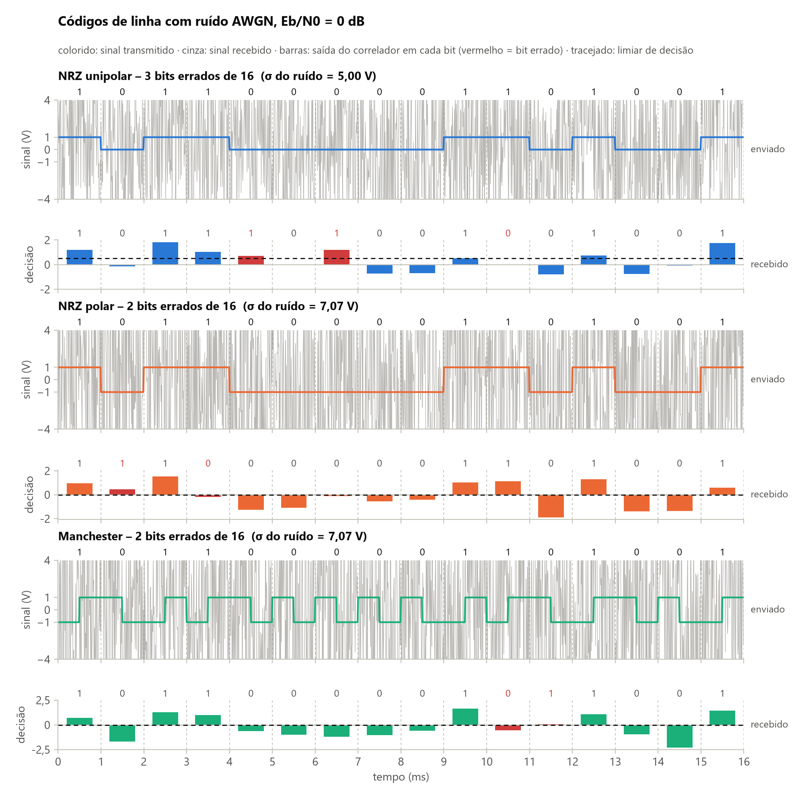{width=15.92}

Em 0 dB, os erros aparecem nos bits cuja barra de decisão cruzou o limiar. A Figura 9 mostra o modo `ruido` com o mesmo Eb/N0 = 0 dB, mas com outra amostra de ruído: desta vez o BPSK errou 3 bits, e o Manchester só 1. Com apenas 16 bits, o número de erros varia muito de uma transmissão para outra, e não dá para comparar as técnicas por ele. Para isso servem as curvas de BER a seguir, com milhões de bits.

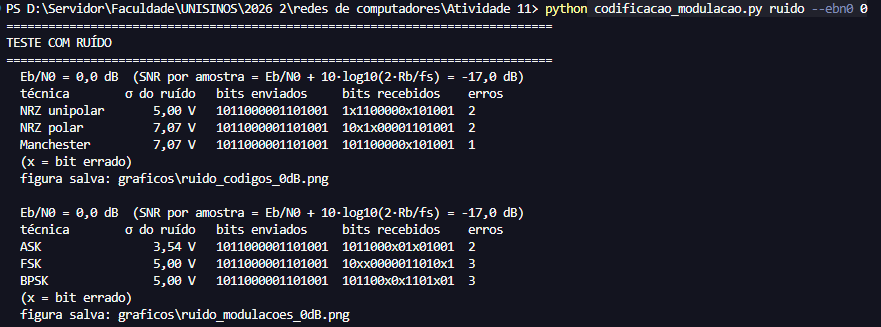{width=15.92}

### Taxa de erro de bits (BER) × Eb/N0

Cada ponto foi simulado com bits aleatórios, gerando as formas de onda completas, até juntar 100 erros ou 2.000.000 de bits. Pontos com BER teórica menor que 10⁻⁶ não foram simulados, porque exigiriam centenas de milhões de bits. Alguns pontos (tabela completa no Anexo):

| Eb/N0 | NRZ unipolar | ASK | FSK | Teoria Q(√(Eb/N0)) | NRZ polar | Manchester | BPSK | Teoria Q(√(2·Eb/N0)) |
|---|---|---|---|---|---|---|---|---|
| 0 dB | 1,61·10⁻¹ | 1,60·10⁻¹ | 1,64·10⁻¹ | 1,59·10⁻¹ | 7,86·10⁻² | 7,72·10⁻² | 7,98·10⁻² | 7,86·10⁻² |
| 4 dB | 5,63·10⁻² | 5,86·10⁻² | 5,80·10⁻² | 5,65·10⁻² | 1,38·10⁻² | 1,25·10⁻² | 1,29·10⁻² | 1,25·10⁻² |
| 8 dB | 5,75·10⁻³ | 5,80·10⁻³ | 5,85·10⁻³ | 6,00·10⁻³ | 1,69·10⁻⁴ | 1,91·10⁻⁴ | 2,20·10⁻⁴ | 1,91·10⁻⁴ |
| 10 dB | 7,86·10⁻⁴ | 8,75·10⁻⁴ | 8,07·10⁻⁴ | 7,83·10⁻⁴ | 3,50·10⁻⁶ | 4,50·10⁻⁶ | 3,00·10⁻⁶ | 3,87·10⁻⁶ |
| 12 dB | 3,40·10⁻⁵ | 3,40·10⁻⁵ | 2,75·10⁻⁵ | 3,43·10⁻⁵ | – | – | – | 9,01·10⁻⁹ |

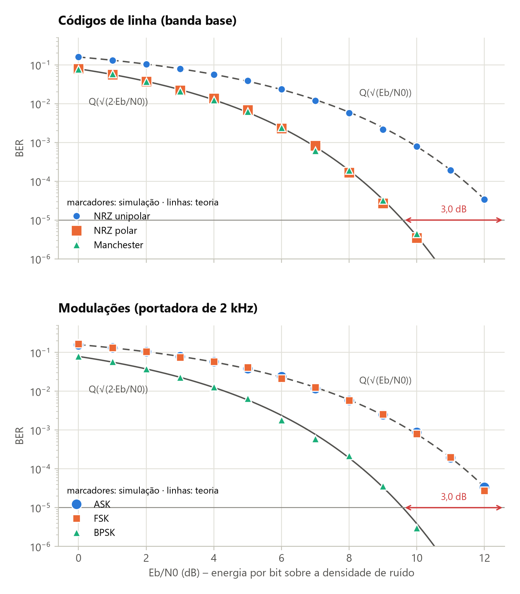{width=13}

As seis técnicas formam **apenas duas curvas**, e as simulações ficaram sobre a teoria em toda a faixa:

- **NRZ polar, Manchester e BPSK:** o bit 0 é o inverso exato do bit 1 (sinais antipodais). BER = Q(√(2·Eb/N0)); BER de 10⁻⁵ com **9,59 dB**.
- **NRZ unipolar, ASK e FSK:** BER = Q(√(Eb/N0)); BER de 10⁻⁵ com **12,60 dB**, ou seja, **3 dB a mais** (o dobro da energia por bit) para a mesma taxa de erro. No unipolar e no ASK, o bit 0 é "nada", e a distância entre os dois sinais é menor que no caso antipodal com a mesma energia média. No FSK, as duas ondas são ortogonais, e o resultado é o mesmo.

---

## 7. Ocupação de banda (espectro)

O programa também calculou o espectro de cada sinal com 4.000 bits aleatórios (Figura 11) e mediu quanta potência fica dentro do lobo principal previsto pela teoria:

| Técnica | Lobo principal | Largura | Potência dentro |
|---|---|---|---|
| NRZ unipolar | 0 a 1 kHz | 1 kHz | 95,1 % |
| NRZ polar | 0 a 1 kHz | 1 kHz | 90,2 % |
| Manchester | 0 a 2 kHz | 2 kHz | 85,6 % |
| ASK | 1 a 3 kHz | 2 kHz | 96,1 % |
| FSK | 1 a 5 kHz | 4 kHz | 99,3 % |
| BPSK | 1 a 3 kHz | 2 kHz | 92,2 % |

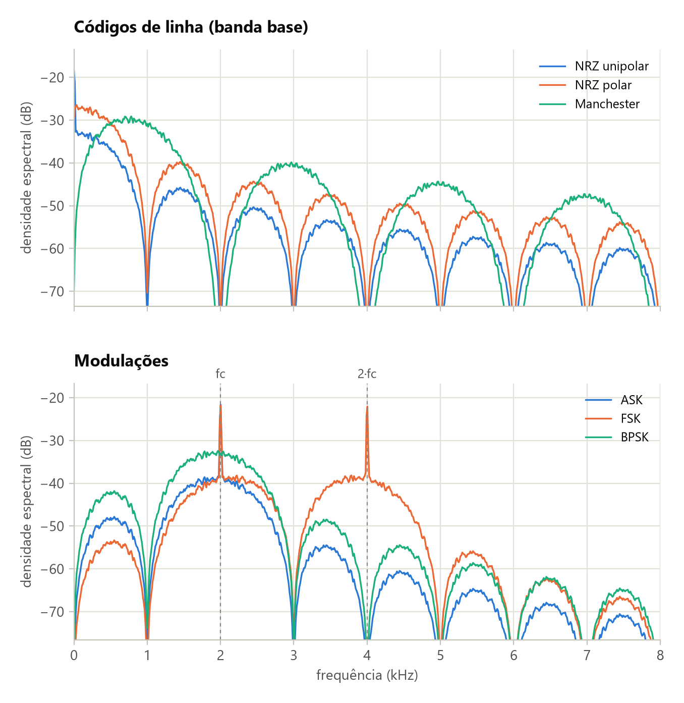{width=13}

- Os códigos de linha ocupam a faixa a partir de 0 Hz. O NRZ unipolar tem uma raia em 0 Hz (o nível médio), e o Manchester não tem componente em 0 Hz, mas ocupa o dobro da banda do NRZ.
- As modulações deslocam o espectro para perto da portadora. O ASK e o BPSK ocupam de 1 a 3 kHz, isto é, **2 kHz, o dobro da banda do sinal original** (1 kHz), como diz o slide 21. O ASK tem também uma raia na portadora, que é potência gasta sem carregar informação.
- O FSK usa duas portadoras e ocupa de 1 a 5 kHz, a maior banda das três modulações. É a "baixa eficiência espectral (duas frequências)" do slide 22.

---

## 8. Análise dos resultados

### Qual a diferença entre codificação de banda base e modulação de uma portadora?

Na **codificação de banda base**, os bits viram diretamente níveis de tensão no meio de transmissão, e o espectro do sinal começa em 0 Hz (Figura 11, parte de cima). O código de linha decide como os níveis e as transições representam cada bit (Figura 2). É o que se usa em cabos, que conduzem desde frequências muito baixas.

Na **modulação**, os bits alteram um parâmetro de uma senoide, a portadora (amplitude, frequência ou fase), e o espectro passa a ficar em volta da frequência da portadora: 1 a 3 kHz em torno de fc = 2 kHz no ASK e no BPSK. Isso é necessário em meios que não deixam passar frequências baixas, como o rádio e a linha telefônica, e permite colocar vários canais no mesmo meio, cada um com a sua portadora. O custo é a banda: o sinal modulado ocupa o dobro da banda do sinal em banda base (2 kHz contra 1 kHz).

Os resultados mostram como as duas coisas estão ligadas. O ASK é o NRZ unipolar multiplicado pela portadora, e o BPSK é o NRZ polar multiplicado pela portadora. Por isso as curvas de BER coincidem: a modulação muda a faixa de frequência, mas não a forma como os bits estão separados entre si.

### Como o código Manchester auxilia na recuperação de sincronismo?

O receptor precisa saber onde cada bit começa e termina (slide 11). No NRZ, o sinal só muda quando o bit muda: os cinco zeros da sequência viram 5 ms de linha parada (Figura 2), e uma sequência longa de bits iguais deixa o receptor sem nenhuma referência. Se o relógio dele estiver um pouco mais rápido ou mais lento que o do transmissor, ele conta bits a mais ou a menos.

No Manchester, **todo bit tem uma transição no meio**. Na sequência testada foram 23 transições contra 8 do NRZ, e o maior trecho sem transição caiu de 5 bits para 1. O próprio sinal carrega o relógio, e o receptor pode se ressincronizar a cada bit, qualquer que seja a mensagem. Como cada bit passa metade do tempo em +V e metade em −V, o nível médio também é sempre zero (0 V contra +0,438 V e −0,125 V nos NRZ). Isso evita a componente DC, que não passa por transformadores e acopladores.

O custo é a largura de banda. Com transições a cada meio bit, o lobo principal do espectro vai até 2 kHz, o dobro do NRZ (Figura 11). Em tolerância ao ruído, o Manchester ficou igual ao NRZ polar (Figura 10). É o código da Ethernet de 10 Mbit/s (IEEE 802.3), com a mesma convenção do slide 14. Nesta simulação o relógio do receptor é considerado perfeito, então o ganho de sincronismo aparece nas transições e no espectro, e não na BER.

### Como ASK, FSK e PSK representam a informação binária?

Cada técnica muda um único parâmetro da portadora e mantém os outros fixos (Figura 5): o **ASK** muda a amplitude (0 ou A), o **FSK** muda a frequência (2 ou 4 kHz) e o **PSK** muda a fase (0° ou 180°).

Os testes com ruído mostraram as consequências dessa escolha:

- **BPSK** é a mais tolerante ao ruído: precisa de 9,59 dB para BER = 10⁻⁵, 3 dB a menos que as outras duas, e usa a mesma banda do ASK. Isso confirma o slide 23 ("maior tolerância a ruído").
- **ASK e FSK** tiveram a mesma BER para a mesma energia média por bit (12,60 dB para 10⁻⁵). O slide 22 diz que o FSK é mais tolerante a ruído que o ASK, e isso vale quando as duas usam a mesma amplitude de pico: o ASK só transmite energia em metade dos bits, então, com o mesmo pico A, a sua energia média é metade da do FSK (A²·Tb/4 contra A²·Tb/2, conferido no modo `validar`), o que equivale a 3 dB a menos. Além disso, o limiar do ASK depende de conhecer a amplitude recebida, que varia com a atenuação do meio, enquanto o FSK compara as duas frequências entre si e não precisa disso.
- **FSK** paga a tolerância com banda: ocupa 4 kHz contra 2 kHz do ASK e do BPSK.

---

## 9. Uso de Inteligência Artificial

**Ferramenta utilizada:** Claude (Anthropic), via Claude Code.

**Etapas em que ajudou:** leitura do enunciado e da aula 13, incluindo os slides que estão só como imagem (convenções do Manchester, tabela do slide 20 e constelações); planejamento (`planejamento.md`); escrita do programa `codificacao_modulacao.py`, com o modo de validação e as figuras; previsão dos resultados antes da primeira execução; e redação deste relatório a partir das saídas reais.

**Como as sugestões foram validadas:**

- O programa foi executado por mim em 14/11/2026, e as tabelas, as figuras e os prints deste relatório são dessa execução. A saída foi idêntica à do teste feito pela IA durante o desenvolvimento, porque a semente do ruído é fixa (2026).
- O modo `validar` conferiu as convenções contra os próprios slides da aula 13 (níveis do slide 13 e setas do slide 14, bit a bit) e passou nas 11 verificações.
- As curvas de BER simuladas foram comparadas com as fórmulas teóricas nas seis técnicas, de 0 a 12 dB.

**Previsões confirmadas pela execução** (feitas no `planejamento.md` antes de rodar):

- 8, 8 e 23 transições; 5, 5 e 1 bit sem transição; nível médio de +0,44, −0,125 e 0 V.
- BER igual para unipolar, ASK e FSK, e igual para polar, Manchester e BPSK, com 9,59 e 12,60 dB para BER = 10⁻⁵.
- Em 16 bits a 0 dB, cerca de 1,3 erro no BPSK e 2,5 no ASK e no FSK. Nas duas transmissões feitas (Tabela da seção 6 e Figura 9), o BPSK errou 0 e 3 bits, o ASK 2 e 2 e o FSK 3 e 3, valores compatíveis com a previsão para tão poucos bits.

**Sugestão confirmada e adaptada:** a IA previu que, pela energia média, ASK e FSK teriam a mesma BER, o que contraria a leitura direta do slide 22 ("FSK é mais tolerante a ruído do que a ASK"). A simulação confirmou o empate (12,60 dB para os dois). Em vez de tratar o slide como errado, a análise foi adaptada para explicar em que condição ele vale: com a mesma amplitude de pico, o ASK tem metade da energia média, o que o modo `validar` também mediu nas amostras.

**Sugestões corrigidas ou adaptadas:**

- A IA notou que os slides da aula 13 trazem convenções opostas para o BPSK (slide 20 contra slides 23 e 26). A convenção usada foi escolhida e escrita de forma explícita no relatório, em vez de seguir só uma das fontes sem comentar.
- O planejamento previa mostrar só o sinal com ruído. Na primeira execução, ficou claro que, com SNR por amostra de −17 dB, a forma de onda recebida parece só ruído, mesmo com poucos bits errados. Foram acrescentadas as barras com a saída do correlador, que mostram como o receptor recupera o bit.
- O planejamento previa as figuras com ruído em 12, 6 e 0 dB. Como em 6 e 12 dB os 16 bits chegariam sem erro, foram usados 10 dB (sem erros) e 0 dB (com erros).
- Ajustes de apresentação feitos pela IA antes da execução oficial: rótulos da teoria que ficavam sob os marcadores no gráfico de BER, marcadores do ASK escondidos atrás dos do FSK (curvas iguais) e números com ponto decimal em vez de vírgula.

---

## 10. Conclusão

Os três códigos de linha e as três modulações foram implementados como formas de onda amostradas, com as convenções da aula 13 conferidas pelo programa contra os próprios slides. Os gráficos mostram que os códigos de linha mudam o nível do sinal ao longo do bit, e as modulações mudam um parâmetro da portadora: amplitude (ASK), frequência (FSK) ou fase (BPSK).

Os testes com ruído mostraram que o que define a tolerância ao ruído é a distância entre os sinais do bit 0 e do bit 1 para a mesma energia. Sinais antipodais (NRZ polar, Manchester e BPSK) precisam de 3 dB a menos que os outros. O Manchester garante uma transição por bit e nível médio zero, ao custo do dobro de banda. O BPSK teve a melhor tolerância ao ruído com a menor banda entre as modulações, o que explica por que o PSK é a técnica mais usada (slide 23). Os mesmos códigos (NRZ e Manchester) e o BPSK são usados no Trabalho 2, em que a comparação continua com a 16-QAM.

---

## Apêndice A – Código-fonte completo (`codificacao_modulacao.py`)

{{codigo:codificacao_modulacao.py}}

## Anexo – Saída completa da execução (`saida_experimentos.txt`)

Saída de `python codificacao_modulacao.py`, executado em 14/11/2026, gravada pelo próprio programa.

{{codigo:saida_experimentos.txt}}
