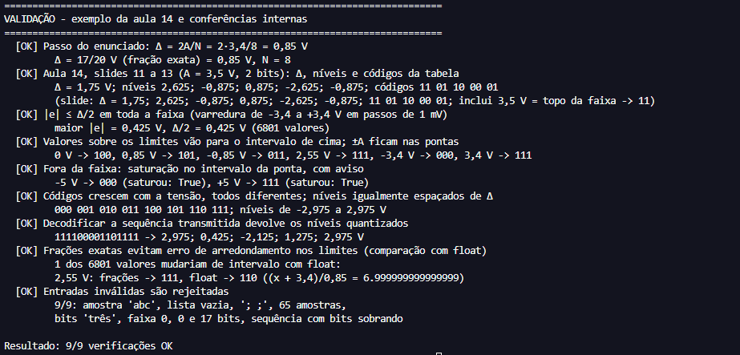
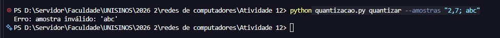
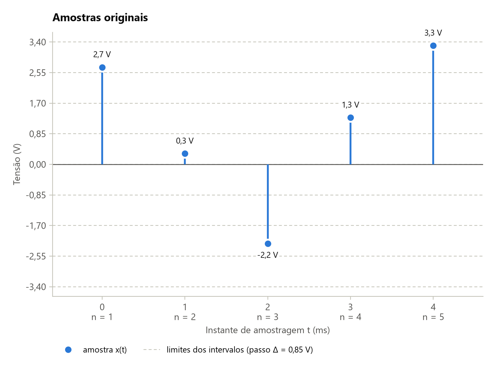
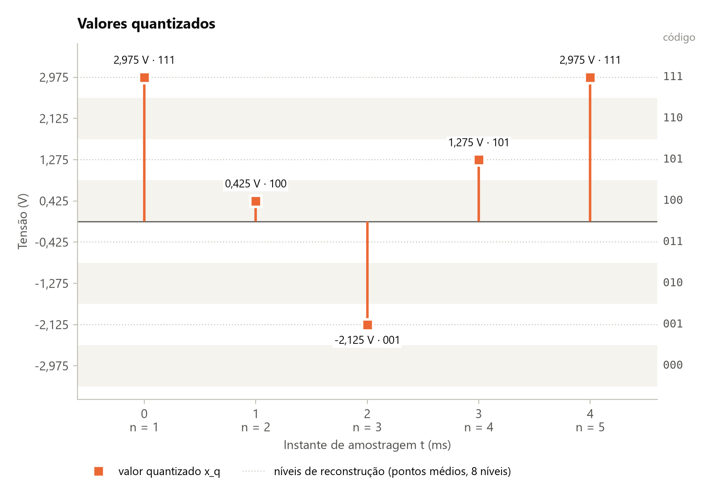
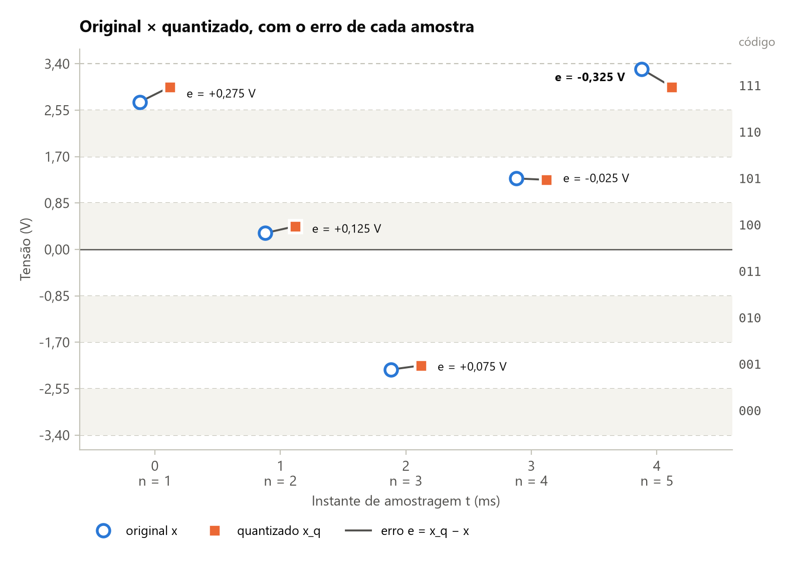
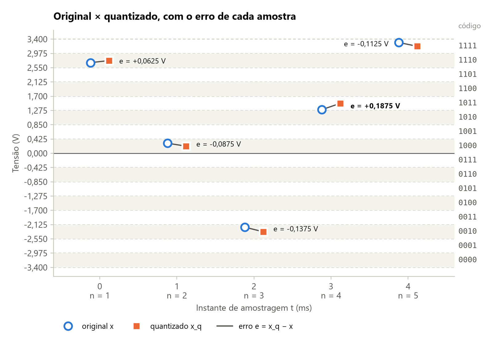

# Atividade 12 – Quantização de Sinais

**Nome:** Matheus Milanezi
**Disciplina:** Redes de Computadores: Internetworking, Roteamento e Transmissão
**Linguagem:** Python 3.14 (arquivo único `quantizacao.py`; matplotlib 3.11 para os gráficos)
**Execução:** 21/11/2026, no PowerShell (Windows 10), dentro da pasta da atividade

---

## 1. Objetivo

Implementar a quantização uniforme de um sinal amostrado: definir o quantizador de 3 bits, encontrar para cada amostra o intervalo, o nível quantizado, o erro e o código binário, montar a sequência de bits transmitida e comparar graficamente as amostras originais com os valores quantizados.

---

## 2. Implementação

### Parâmetros

| Parâmetro | Valor | Observação |
|---|---|---|
| Amostras | 2,7; 0,3; −2,2; 1,3; 3,3 V | Enunciado |
| Faixa de operação | −3,4 V a +3,4 V (A = 3,4 V) | Enunciado |
| Bits por amostra | b = 3 | N = 2³ = 8 intervalos |
| Passo de quantização | Δ = 2A/N = 0,85 V | Aula 14, slide 10 |
| Nível de reconstrução | ponto médio de cada intervalo | Enunciado |
| Período de amostragem | Ts = 1 ms (fs = 1.000 amostras/s) | **Adotado**: o enunciado não informa; mesmo valor do exemplo do slide 9 |

O período de amostragem só define a posição das amostras no eixo do tempo dos gráficos (t = 0, 1, 2, 3 e 4 ms) e a taxa de bits da seção 6. Ele não muda a quantização.

### Convenções adotadas

O enunciado pede que a regra dos limites e a ordem dos códigos fiquem explícitas. Os slides 12 e 13 escrevem os intervalos com colchetes dos dois lados (por exemplo, [3,5; 1,75]) e não dizem a qual intervalo pertence um valor que cai exatamente sobre um limite. Foram adotadas as regras abaixo:

| Item | Regra adotada |
|---|---|
| Intervalo k (k = 0 a 7) | [−A + k·Δ; −A + (k+1)·Δ): fechado à esquerda e aberto à direita |
| Último intervalo (k = 7) | Fechado nos dois lados, [2,55; 3,40], para que +3,4 V pertença a ele |
| Valor sobre um limite interno | Vai para o intervalo de cima (ex.: 0 V → 100; 0,85 V → 101) |
| Cálculo do intervalo | k = ⌊(x + A)/Δ⌋, limitado a 0 … 7 |
| Valor fora da faixa | Saturação: vai para o intervalo da ponta, e o programa avisa |
| Nível quantizado | x_q = −A + (k + ½)·Δ (ponto médio) |
| Código | k em binário natural de 3 bits: do intervalo mais negativo (000) ao mais positivo (111) |
| Erro de quantização | e = x_q − x (nível quantizado menos tensão original) |

A ordem dos códigos é a mesma do slide 13, em que o intervalo mais baixo recebe 00 e o mais alto recebe 11. Essas regras reproduzem a tabela do exemplo da aula, conferida no modo `validar` (seção 3).

**Aritmética exata:** o programa faz as contas com frações (`fractions.Fraction`), e não com números de ponto flutuante. Assim, 2,7 é guardado como 27/10 e 0,85 como 17/20, e um valor que cai exatamente sobre um limite vai sempre para o intervalo certo. A seção 3 mostra um caso em que o ponto flutuante erraria.

### Estrutura do programa

| Função | O que faz |
|---|---|
| `Quantizador` (classe) | Guarda A e b; calcula N, Δ, os limites, o nível e o código de cada intervalo |
| `Quantizador.intervalo` | Acha o intervalo k de uma tensão, com a regra dos limites e a saturação |
| `quantizar` | Quantiza a lista de amostras: intervalo, nível, erro e código de cada uma |
| `decodificar` | Faz o papel do receptor: corta a sequência em grupos de b bits e devolve os níveis |
| `tabela_quantizador`, `tabela_amostras`, `tabela_passo` | Imprimem as tabelas das seções 4 a 6 |
| `figura_originais`, `figura_quantizadas`, `figura_comparacao` | Geram os gráficos |
| `modo_validar` | Confere o exemplo da aula 14 e as regras do quantizador |

Formas de execução:

```
python quantizacao.py                                                todos os experimentos
python quantizacao.py quantizar --amostras "2,7; 0,3" --bits 4       outras amostras, bits ou faixa
python quantizacao.py validar                                        verificações automáticas
```

As figuras são salvas na pasta `graficos/`, e a saída completa é gravada em `saida_experimentos.txt`. **A saída completa da execução está no Anexo**, e o código-fonte completo, no **Apêndice A**.

---

## 3. Validação da implementação

Antes dos experimentos, o modo `validar` conferiu o programa com o exemplo da aula 14 e com propriedades que todo quantizador uniforme precisa ter. As 9 verificações passaram (Figura 1):

| Verificação | Resultado |
|---|---|
| Passo do enunciado | Δ = 17/20 V = 0,85 V, N = 8 |
| Exemplo da aula 14, slides 11 a 13 (A = 3,5 V, 2 bits) | Δ = 1,75 V; níveis 2,625; −0,875; 0,875; −2,625; −0,875 V; códigos 11 01 10 00 01, iguais aos da tabela do slide 13 |
| \|e\| ≤ Δ/2 em toda a faixa | Varredura de −3,4 a +3,4 V em passos de 1 mV (6.801 valores): maior \|e\| = 0,425 V = Δ/2 |
| Valores sobre os limites | 0 → 100; 0,85 → 101; −0,85 → 011; 2,55 → 111; −3,4 → 000; +3,4 → 111 |
| Fora da faixa | −5 V → 000 e +5 V → 111, com aviso de saturação |
| Códigos e níveis | Códigos de 000 a 111 em ordem crescente com a tensão; níveis espaçados de exatamente Δ |
| Receptor | Decodificar 111100001101111 devolve os níveis quantizados |
| Frações exatas contra ponto flutuante | Só 2,55 V mudaria de intervalo com ponto flutuante: (2,55 + 3,4)/0,85 = 6,999999999999999, que daria 110 em vez de 111 |
| Entradas inválidas | 9/9 rejeitadas (amostra "abc", lista vazia, 65 amostras, faixa 0, 0 ou 17 bits etc.) |

No exemplo da aula, a amostra de 3,5 V está exatamente no topo da faixa e recebeu o código 11, como no slide. Isso confirma a decisão de fechar o último intervalo.

{width=15.92}

Entradas inválidas são recusadas com uma mensagem de erro (Figura 2):

{width=14}

---

## 4. Parte 1 – Definição do quantizador

Com A = 3,4 V e b = 3 bits:

- Número de intervalos: N = 2ᵇ = 2³ = **8**
- Passo de quantização (slide 10): **Δ = 2A/N = 2 · 3,4 / 8 = 6,8 / 8 = 0,85 V**
- Erro máximo de uma amostra dentro da faixa: Δ/2 = **0,425 V**
- Nível do intervalo k (ponto médio): x_q = −3,4 + (k + ½) · 0,85. Por exemplo, para k = 7: −3,4 + 7,5 · 0,85 = 2,975 V.

Os oito intervalos, com os níveis de reconstrução e os códigos:

| k | Intervalo (V) | Nível de reconstrução (V) | Código |
|---|---|---|---|
| 0 | [−3,40; −2,55) | −2,975 | 000 |
| 1 | [−2,55; −1,70) | −2,125 | 001 |
| 2 | [−1,70; −0,85) | −1,275 | 010 |
| 3 | [−0,85; 0,00) | −0,425 | 011 |
| 4 | [0,00; 0,85) | 0,425 | 100 |
| 5 | [0,85; 1,70) | 1,275 | 101 |
| 6 | [1,70; 2,55) | 2,125 | 110 |
| 7 | [2,55; 3,40] | 2,975 | 111 |

Os níveis ficam a Δ = 0,85 V uns dos outros e são simétricos em torno de 0 V. Como os níveis são pontos médios, nenhum deles vale exatamente 0 V: uma amostra de 0 V vai para 0,425 V (código 100).

---

## 5. Parte 2 – Quantização e codificação das amostras

Para cada amostra, o intervalo sai de k = ⌊(x + 3,4)/0,85⌋:

| Amostra | Cálculo de k | k |
|---|---|---|
| 2,7 V | (2,7 + 3,4)/0,85 = 6,1/0,85 = 7,18 | 7 |
| 0,3 V | (0,3 + 3,4)/0,85 = 3,7/0,85 = 4,35 | 4 |
| −2,2 V | (−2,2 + 3,4)/0,85 = 1,2/0,85 = 1,41 | 1 |
| 1,3 V | (1,3 + 3,4)/0,85 = 4,7/0,85 = 5,53 | 5 |
| 3,3 V | (3,3 + 3,4)/0,85 = 6,7/0,85 = 7,88 | 7 |

Nenhuma amostra cai sobre um limite (os limites são múltiplos de 0,85 V a partir de −3,4 V), então a regra dos limites não precisou ser aplicada aqui. Tabela de quantização obtida pelo programa:

| Índice (n) | Instante t | Tensão original x (V) | Intervalo (V) | Nível quantizado x_q (V) | Erro e = x_q − x (V) | \|e\| (V) | Código |
|---|---|---|---|---|---|---|---|
| 1 | 0 ms | 2,7 | [2,55; 3,40] | 2,975 | +0,275 | 0,275 | 111 |
| 2 | 1 ms | 0,3 | [0,00; 0,85) | 0,425 | +0,125 | 0,125 | 100 |
| 3 | 2 ms | −2,2 | [−2,55; −1,70) | −2,125 | +0,075 | 0,075 | 001 |
| 4 | 3 ms | 1,3 | [0,85; 1,70) | 1,275 | −0,025 | 0,025 | 101 |
| 5 | 4 ms | 3,3 | [2,55; 3,40] | 2,975 | **−0,325** | **0,325** | 111 |

Concatenando os códigos na ordem das amostras:

**111 | 100 | 001 | 101 | 111 → sequência transmitida: 111100001101111** (5 amostras × 3 bits = 15 bits)

O programa também decodificou a sequência, como faria o receptor, cortando-a em grupos de 3 bits: o resultado foi 2,975; 0,425; −2,125; 1,275; 2,975 V. O receptor recupera os níveis quantizados, e não as tensões originais. A diferença entre os dois é o erro de quantização, que não pode ser desfeito.

As amostras 1 e 5 (2,7 V e 3,3 V) caem no mesmo intervalo e recebem o mesmo código 111. Embora estejam 0,6 V uma da outra, o receptor não tem como distingui-las: as duas chegam como 2,975 V.

---

## 6. Parte 3 – Gráficos e análise

### Gráficos

A Figura 3 mostra as amostras originais nos instantes de amostragem. As linhas tracejadas são os limites dos intervalos, a cada Δ = 0,85 V, e o eixo de tensão está marcado nesses limites.

{width=13.5}

A Figura 4 mostra os valores quantizados nos mesmos instantes. O eixo de tensão está marcado nos oito níveis de reconstrução, e o código de cada nível aparece à direita. As faixas em cinza alternado são os intervalos.

{width=13.5}

Como comparação adicional, a Figura 5 mostra os dois sinais juntos: o círculo é a amostra original, o quadrado é o valor quantizado, e a ligação entre eles mostra o tamanho e o sentido do erro.

{width=13.5}

Comparando os dois sinais: todas as amostras ficaram no mesmo intervalo em que estavam, mas foram "puxadas" para o meio dele. As amostras 1, 2 e 3 subiram (erro positivo), e as amostras 4 e 5 desceram (erro negativo). Nenhum erro passou de Δ/2 = 0,425 V. O erro RMS das cinco amostras foi de 0,202 V, perto do valor de referência Δ/√12 = 0,245 V, que é o erro RMS esperado quando as amostras se espalham por igual dentro dos intervalos.

### Como o passo de quantização afeta a precisão?

O passo Δ é a largura de cada intervalo. Toda tensão dentro de um intervalo é trocada pelo mesmo nível, o ponto médio, então o erro de uma amostra pode chegar a Δ/2. **Quanto menor o passo, menor o erro máximo e mais preciso é o sinal quantizado.** Como Δ = 2A/2ᵇ, cada bit a mais por amostra divide o passo por dois, e com ele o erro máximo.

O programa quantizou as mesmas cinco amostras com 1 a 8 bits:

| b | N | Δ (V) | Δ/2 (V) | Maior \|e\| (V) | Erro RMS (V) | Códigos distintos | Taxa de bits (bit/s) |
|---|---|---|---|---|---|---|---|
| 1 | 2 | 3,4000 | 1,7000 | 1,6000 | 1,0890 | 2 de 5 | 1.000 |
| 2 | 4 | 1,7000 | 0,8500 | 0,7500 | 0,4924 | 3 de 5 | 2.000 |
| **3** | **8** | **0,8500** | **0,4250** | **0,3250** | **0,2016** | **4 de 5** | **3.000** |
| 4 | 16 | 0,4250 | 0,2125 | 0,1875 | 0,1251 | 5 de 5 | 4.000 |
| 5 | 32 | 0,2125 | 0,1062 | 0,0812 | 0,0445 | 5 de 5 | 5.000 |
| 6 | 64 | 0,1062 | 0,0531 | 0,0469 | 0,0308 | 5 de 5 | 6.000 |
| 7 | 128 | 0,0531 | 0,0266 | 0,0203 | 0,0126 | 5 de 5 | 7.000 |
| 8 | 256 | 0,0266 | 0,0133 | 0,0117 | 0,0078 | 5 de 5 | 8.000 |

- O maior erro ficou sempre abaixo de Δ/2 e caiu de 1,6 V (1 bit) para 0,325 V (3 bits) e 0,012 V (8 bits). O erro RMS acompanhou Δ/√12.
- Com 3 bits, só 4 das 5 amostras têm códigos diferentes (as amostras 1 e 5 se juntam). A partir de 4 bits, as cinco ficam distinguíveis.
- O preço da precisão é a taxa de bits. Com fs = 1.000 amostras/s, a taxa é R = b · fs (como no exemplo do slide 15): cada bit a mais por amostra custa mais 1.000 bit/s, e o canal precisa de mais banda para transmitir.

A Figura 6 repete a comparação com 4 bits (comando `quantizar --bits 4`). Com Δ = 0,425 V, todos os erros ficaram abaixo de 0,2125 V, e a sequência passou a ter 20 bits: 1110 1000 0010 1011 1111.

{width=13.5}

### Qual amostra apresenta o maior erro absoluto?

A **amostra 5 (3,3 V)**, com |e| = **0,325 V**. Ela está no intervalo [2,55; 3,40], cujo ponto médio é 2,975 V, e é a que fica mais longe do ponto médio do seu intervalo: 0,325 V acima, perto do topo da faixa. A amostra 1 (2,7 V), no mesmo intervalo, ficou 0,275 V abaixo do ponto médio. A de menor erro é a amostra 4 (1,3 V), só 0,025 V abaixo do nível 1,275 V.

O tamanho do erro não depende da tensão da amostra, e sim da distância dela até o ponto médio do intervalo. Isso aparece quando o passo muda: com 4 bits, o maior erro passou a ser o da amostra 4 (1,3 V → 1,4875 V, |e| = 0,1875 V), e a amostra 5 caiu para 0,1125 V.

---

## 7. Uso de Inteligência Artificial

**Ferramenta utilizada:** Claude (Anthropic), via Claude Code.

**Etapas em que ajudou:** leitura do enunciado e da aula 14, incluindo os slides 10 a 13, que trazem a fórmula do passo e as tabelas do exemplo como imagem; planejamento (`planejamento.md`), com a escolha das regras de limite e de código; escrita do programa `quantizacao.py`, com o modo de validação e os gráficos; previsão dos resultados antes da execução; e redação deste relatório a partir da saída real.

**Como os cálculos e os gráficos foram verificados:**

- O programa foi executado por mim em 21/11/2026. As tabelas, as figuras e os prints deste relatório são dessa execução.
- O modo `validar` reproduziu a tabela do exemplo da aula 14 (slides 11 a 13): mesmo passo, mesmos níveis e mesmos códigos.
- Os valores de k, dos níveis e dos erros foram recalculados na seção 5 pelas fórmulas Δ = 2A/N, k = ⌊(x + A)/Δ⌋ e x_q = −A + (k + ½)·Δ, e batem com a saída do programa.
- Os gráficos foram comparados com a tabela: cada ponto está no instante e na tensão da tabela, e cada valor quantizado está no nível do código mostrado à direita.

**Previsões confirmadas pela execução** (feitas no `planejamento.md` antes de rodar): Δ = 0,85 V, a tabela dos oito intervalos, os cinco códigos, a sequência 111100001101111 e o maior erro na amostra 5 (0,325 V), além de as amostras 1 e 5 receberem o mesmo código.

**Sugestão confirmada:** a regra dos limites não está nos slides. A IA propôs intervalos fechados à esquerda, com o último fechado nos dois lados. A proposta foi confirmada pelo exemplo da aula, em que 3,5 V (o topo da faixa) recebe o código 11, e o modo `validar` conferiu também os limites internos.

**Sugestão que precisou ser conferida:** a IA sugeriu fazer as contas com frações exatas, porque o ponto flutuante poderia errar nos limites. Para conferir se isso acontecia de fato, o modo `validar` comparou as duas formas em 6.801 tensões. Só uma mudou: 2,55 V, que é exatamente o limite entre 110 e 111. Em ponto flutuante, (2,55 + 3,4)/0,85 dá 6,999999999999999, e a amostra cairia em 110. Com frações, ela fica corretamente em 111. Nenhuma das cinco amostras do enunciado cai em um limite, então o resultado da atividade seria o mesmo nos dois casos, mas o quantizador estaria errado para outras entradas.

**Correções feitas antes da execução oficial:**

- Na primeira versão, o programa mostrava os limites com 2 casas e os níveis com 3. Ao testar com 4 bits, valores como 2,125 V e 0,2125 V apareciam arredondados (2,12 e 0,212). O número de casas passou a acompanhar o passo, como se vê na Figura 6.
- No primeiro gráfico de comparação, o círculo e o quadrado de cada amostra ficavam um em cima do outro, e o rótulo do erro da amostra 5 cobria o código 111. Os dois marcadores foram afastados lateralmente e o rótulo foi reposicionado.

---

## 8. Conclusão

O quantizador uniforme de 3 bits dividiu a faixa de ±3,4 V em 8 intervalos de 0,85 V. As cinco amostras foram representadas pelos pontos médios dos seus intervalos e geraram a sequência de 15 bits 111100001101111. Todos os erros ficaram abaixo de Δ/2 = 0,425 V, e o maior foi o da amostra 5 (0,325 V).

A quantização é a etapa em que a digitalização perde informação: tensões diferentes no mesmo intervalo viram o mesmo código, como aconteceu com 2,7 V e 3,3 V. O passo controla essa perda. Cada bit a mais por amostra divide o erro máximo por dois, mas aumenta a taxa de bits na mesma proporção. Escolher o número de bits é, portanto, escolher entre a precisão do sinal e a banda necessária para transmiti-lo.

---

## Apêndice A – Código-fonte completo (`quantizacao.py`)

{{codigo:quantizacao.py}}

## Anexo – Saída completa da execução (`saida_experimentos.txt`)

Saída de `python quantizacao.py`, executado em 21/11/2026, gravada pelo próprio programa.

{{codigo:saida_experimentos.txt}}
